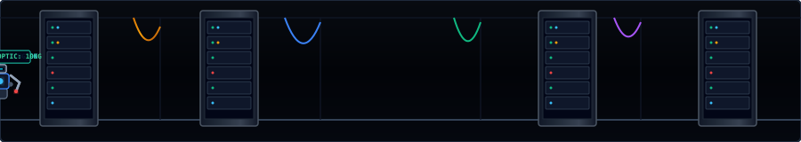

<!-- =========================================================
     GITHUB PROFILE README — TOP-DOWN DATA OFFICE & AI EDITION
     ========================================================= -->

  
  
  

<!-- TOP-DOWN RPG DATA SCIENCE OFFICE -->

---

## About Me & Tech Stack

I'm Mahendra, a Data Science student focused on machine learning, analytics, and practical AI. I enjoy working with data, building useful tools, and learning how to make AI systems more reliable and explainable.

<table>
  <tr>
    <td width="50%" valign="top">
      <strong>Areas of Focus</strong>
      <ul>
        <li><strong>Artificial Intelligence:</strong> Applied ML, NLP, and AI agents</li>
        <li><strong>Data Science:</strong> Predictive analytics & statistical modeling</li>
        <li><strong>Data Engineering:</strong> ETL pipelines, transformations & SQL</li>
        <li><strong>Business Intelligence:</strong> Power BI, dashboards & reporting</li>
        <li><strong>Research:</strong> Reliable AI, explainable ML & decision support</li>
      </ul>
    </td>
    <td width="50%" valign="top">
      <strong>Core Stack</strong>  
        
      
      
      
      
      
    </td>
  </tr>
</table>

---

## Projects & Current Focus

<table>
  <tr>
    <td width="50%" valign="top">
      <strong>Featured Projects</strong>
      <ul>
        <li>
          <strong><a href="https://github.com/mahendravelagapudi099-wq/customer-trends-data-analysis-SQL-Python-PowerBI">Customer Trends Analysis</a>:</strong>
          Customer insights, business trends, and interactive reporting using SQL, Python, and Power BI.
        </li>
        <li>
          <strong><a href="https://github.com/mahendravelagapudi099-wq/hyderabad-air-quality-monitor">Hyderabad Air Quality Monitor</a>:</strong>
          Automated data ingestion, pollutant analysis, anomaly detection, and interactive dashboards.
        </li>
        <li>
          <strong><a href="https://github.com/mahendravelagapudi099-wq/telugu-text-classifier">Telugu Text Classifier</a>:</strong>
          Telugu sentiment classification using TF-IDF, transformer models, and statistical evaluation.
        </li>
        <li>
          <strong><a href="https://github.com/mahendravelagapudi099-wq/messy-pdf-rag-chatbot">Messy PDF RAG Chatbot</a>:</strong>
          Document question-answering with PDF extraction, vector search, and grounded citations.
        </li>
        <li>
          <strong><a href="https://github.com/mahendravelagapudi099-wq/lunar-lander-reward-shaping-lab">Lunar Lander Reward Shaping Lab</a>:</strong>
          PPO reinforcement-learning experiments comparing reward strategies and reward-hacking behavior.
        </li>
      </ul>
      <a href="https://github.com/mahendravelagapudi099-wq?tab=repositories">View all repositories →</a>
    </td>
    <td width="50%" valign="top">
      <strong>Current R&D Focus</strong>
      <ul>
        <li>
          <strong>Applied AI:</strong>
          Building practical LLM applications, grounded retrieval workflows, and agent-based systems.
        </li>
        <li>
          <strong>Data Engineering:</strong>
          Developing reliable ingestion, validation, transformation, storage, and automated pipelines.
        </li>
        <li>
          <strong>Predictive Analytics:</strong>
          Exploring feature engineering, model evaluation, forecasting, and statistical uncertainty.
        </li>
        <li>
          <strong>Reliable ML:</strong>
          Investigating model explainability, data quality, error analysis, and reproducibility.
        </li>
        <li>
          <strong>Reinforcement Learning:</strong>
          Studying PPO policies, reward design, controlled experiments, and reward-hacking prevention.
        </li>
      </ul>
    </td>
  </tr>
</table>

---

## Let's Connect

I'm always open to connecting with developers, data scientists, AI engineers, and researchers who enjoy building practical, data-driven solutions.

  
  

<strong>Build thoughtfully. Learn continuously. Make data useful.</strong>

<!-- FOOTER HALLWAY CORRIDOR WITH ROAMING BOTS -->

